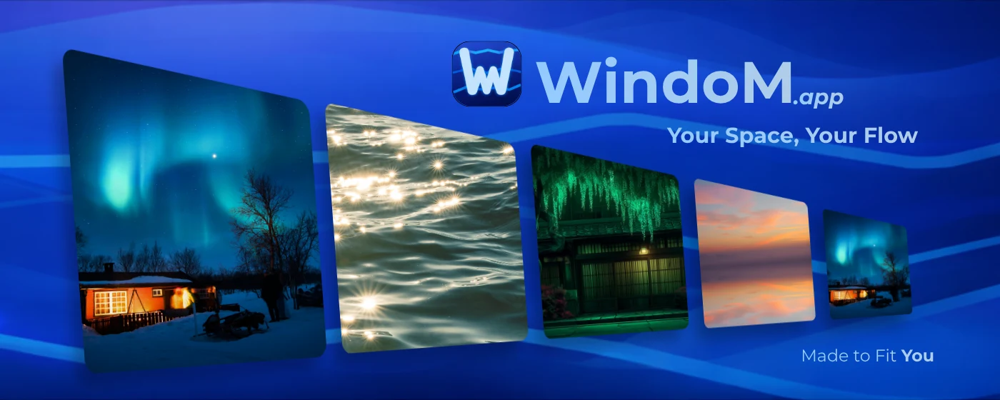
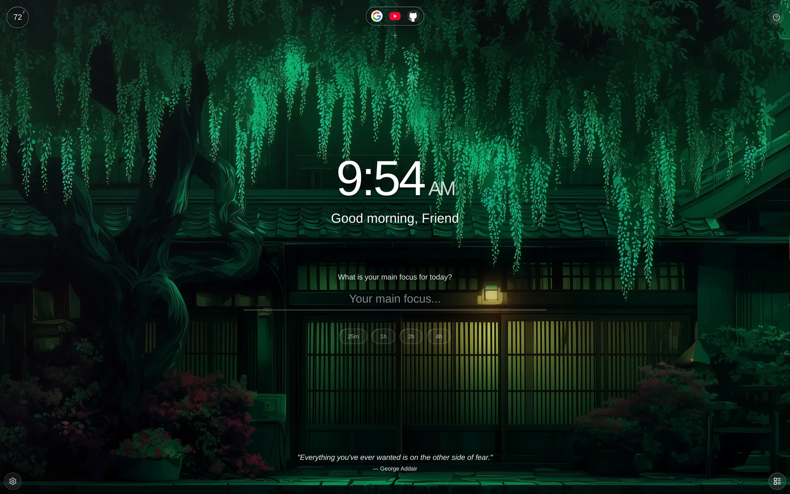
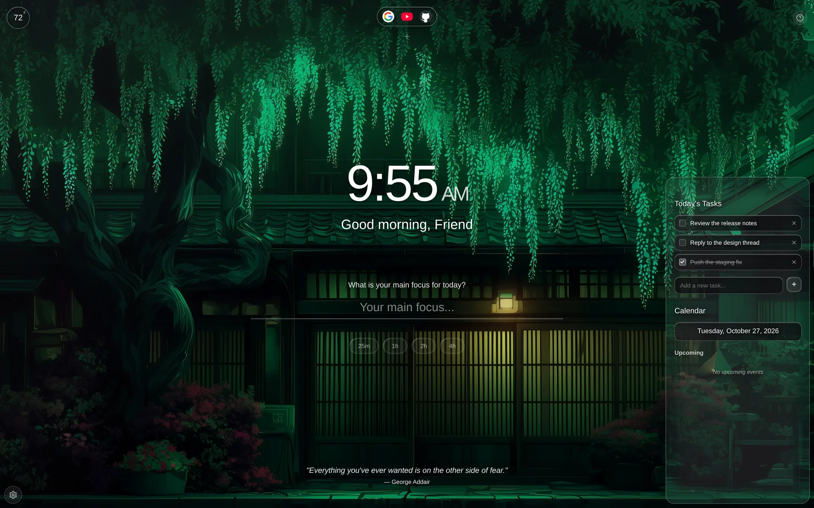
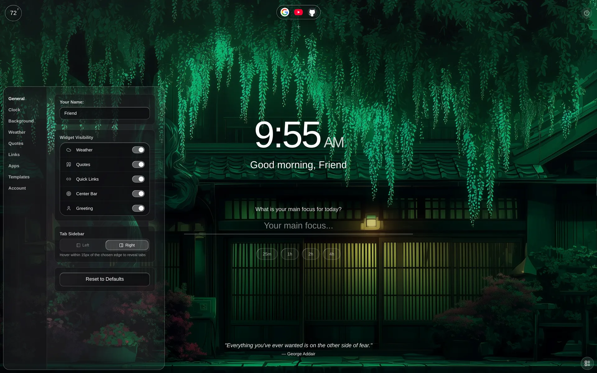

<div align="center">



<br />

**A Chrome new tab that is actually worth opening.**

Your clock, the weather, today's tasks, your calendar, what's playing, the pull
requests waiting on you and live market prices — on a background that changes
with the hour. Most of it works the moment you install it, with no account.

[](https://chromewebstore.google.com/detail/windom/comcnbccalbfcegbmaemancbhgpijkpb)
[](https://windom.app)

[](CHANGELOG.md)
[](LICENSE)
[](https://chromewebstore.google.com/detail/windom/comcnbccalbfcegbmaemancbhgpijkpb)
[](https://github.com/YehudaBriskman/WindoM/issues)

<br />



</div>

---

## What you get

Everything below works with no account and no API keys.

| Feature | What it does |
|---|---|
| Clock and greeting | Your time, your name, and a greeting that follows the hour |
| Weather | Current conditions from Open-Meteo. No key, no sign-up |
| Backgrounds | Rotating Unsplash photography, or your own image |
| Todos | A task list that lives in the sidebar |
| Focus timer | Set an intention, pick 25m to 4h, and the tab dims until it ends |
| Quick links | A dock of the sites you actually open |
| Search | Straight to Google, Bing, DuckDuckGo or Brave |
| Daily quote | One a day, clickable for another |
| Tab sidebar | Your open tabs, from any page |
| Recent | Where you have just been |
| Layout templates | Preset arrangements — Minimal, Deep Focus, Dashboard and more |
| Finance | Live stocks and crypto from Yahoo Finance and CoinGecko |

These need a free WindoM account:

| Feature | What it does |
|---|---|
| Google Calendar | Today and what's coming, read-only |
| Spotify | Now playing, playback controls, and your top tracks |
| GitHub | Notifications, review requests and assigned issues |
| Settings sync | Your setup follows you to any browser you sign in to |

---

## Screenshots

<div align="center">
<table>
<tr>
<td width="50%">
<br/>
<sub><b>Tasks and calendar, in one sidebar</b></sub>
</td>
<td width="50%">
<br/>
<sub><b>Every widget is optional</b></sub>
</td>
</tr>
</table>
</div>

---

## Install

**From the Chrome Web Store** — [install WindoM](https://chromewebstore.google.com/detail/windom/comcnbccalbfcegbmaemancbhgpijkpb).

**From source** — see the [local setup guide](https://windom.app/local-setup). You
will need Node 22 or newer, and Docker if you want the backend.

| Browser | Status |
|---|---|
| Chrome | Supported |
| Edge, Brave, and other Chromium browsers | Supported |
| Firefox | Not supported — its Manifest V3 differs |

---

## How it is built

| | |
|---|---|
| **Extension** | React 19, TypeScript, Vite 8, Chrome Manifest V3 |
| **Styling** | Hand-written CSS — no framework. The glass is a real SVG displacement filter, not a blur |
| **State** | `chrome.storage.sync` for settings, `chrome.storage.local` for tokens and caches |
| **Backend** | Fastify 5, Drizzle ORM, PostgreSQL 17, hosted on Fly.io |
| **Auth** | JWT with refresh-token rotation; third-party tokens encrypted at rest with AES-256-GCM |
| **Site** | React Router, prerendered to static HTML, deployed to GitHub Pages |

```
WindoM/
├── web/        Chrome extension
├── backend/    Fastify API
├── site/       windom.app
└── .github/    CI, release and deploy workflows
```

---

## Privacy

WindoM has no analytics and no tracking of any kind.

Your settings, tasks and quick links live in your browser. An account is
optional and exists only to connect Calendar, Spotify and GitHub, and to sync
your settings between browsers. Calendar is requested read-only. Weather,
quotes and market prices come from public APIs that need no key and no
identity.

The full [privacy policy](https://windom.app/privacy) lists every service the
extension contacts and what is sent to each.

---

## Contributing

Issues and pull requests are welcome — see [CONTRIBUTING.md](CONTRIBUTING.md).

- [Report a bug](https://github.com/YehudaBriskman/WindoM/issues)
- [Suggest a feature](https://github.com/YehudaBriskman/WindoM/discussions)
- [Review it on the Chrome Web Store](https://chromewebstore.google.com/detail/windom/comcnbccalbfcegbmaemancbhgpijkpb)

---

## Links

| | |
|---|---|
| Website | [windom.app](https://windom.app) |
| User guide | [windom.app/guide](https://windom.app/guide) |
| Support | [windom.app/support](https://windom.app/support) |
| Local setup | [windom.app/local-setup](https://windom.app/local-setup) |
| Privacy policy | [windom.app/privacy](https://windom.app/privacy) |
| Changelog | [CHANGELOG.md](CHANGELOG.md) |
| LinkedIn | [WindoM](https://www.linkedin.com/company/windom-app/) |

---

MIT © [Yehuda Briskman](https://github.com/YehudaBriskman) — see [LICENSE](LICENSE).
